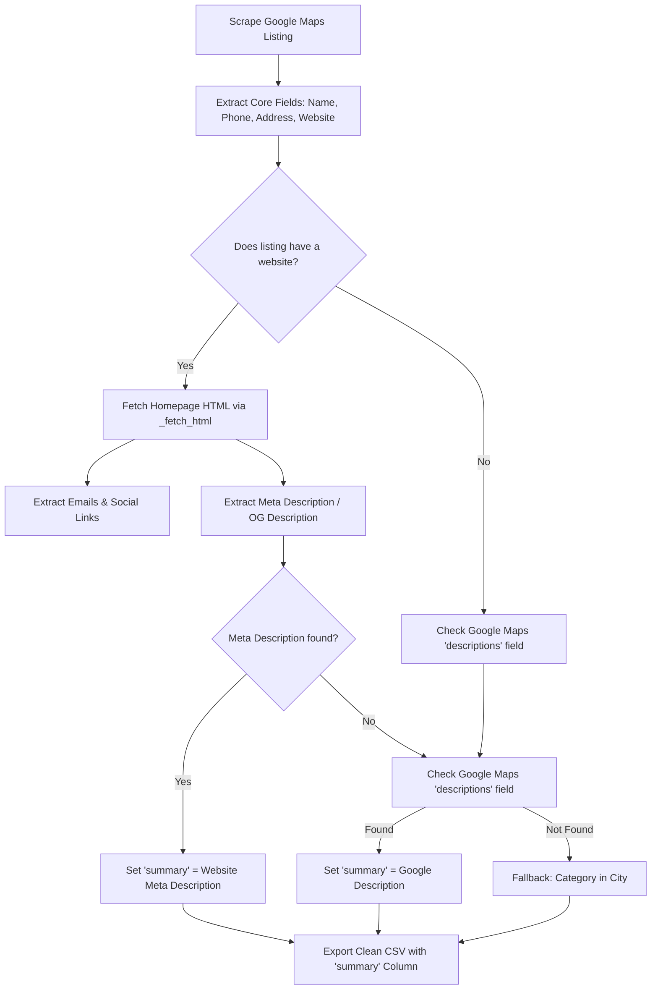

# Lead Summary Enrichment Plan (Option 1 & Option 2)

This plan outlines the architecture, data flow, and implementation steps to add a **business summary** column to each scraped lead without requiring paid API keys or external LLM tokens.

---

## 1. Overview of Options

| Feature | Option 1: Google Maps Built-in Description | Option 2: Website Meta Description | Combined Hybrid (Recommended) |
| :--- | :--- | :--- | :--- |
| **Data Source** | Google Maps metadata (`descriptions` & `about`) | Business homepage `<meta name="description">` and `<meta property="og:description">` | Website Meta Description with fallback to Google Maps Description |
| **Speed Impact** | 0 seconds (Already captured by the engine) | 0 seconds additional (Reuses existing website visit from `--socials`) | 0 seconds additional |
| **Cost** | 100% Free | 100% Free (Pure regex/HTML parsing) | 100% Free |
| **Coverage** | ~30%–50% of businesses have a Google editorial description | ~70%–85% of businesses with websites have a meta description | **~90%+ coverage** across all leads |
| **Data Quality** | Brief, Google-generated editorial overview | Direct, accurate, company-authored mission/service summary | Highest quality & best completeness |

---

## 2. Data Sources & Extraction Logic

### Option 1: Google Maps Description
* **Raw Fields Collected by Scraper:**
  - `descriptions`: Google's editorial description of the place.
  - `about`: Category details, amenities, and service attributes.
* **Extraction Strategy:**
  - Keep `descriptions` in the lead dictionary instead of dropping it during column pruning.
  - Clean HTML tags and excessive whitespace.

### Option 2: Website Meta Description
* **Target Tags in Homepage HTML:**
  - Standard description: `<meta name="description" content="...">`
  - OpenGraph description: `<meta property="og:description" content="...">`
  - Page title fallback: `<title>...</title>`
* **Extraction Strategy:**
  - Leverage the existing `_fetch_html()` function used during `--socials` and email scanning.
  - Use regex to extract the `content` attribute from the description tags.
  - Decode HTML entities (e.g., `&amp;` -> `&`, `&#39;` -> `'`) and truncate to a clean 150–200 character summary.

---

## 3. Recommended Hybrid Workflow (Best of Both)



---

## 4. Output CSV Schema Comparison

### Current Schema:
```text
title, phone, emails, website, category, address, review_rating, review_count, instagram, facebook, linkedin
```

### Proposed New Schema (With Summary):
```text
title, phone, emails, website, category, address, summary, review_rating, review_count, instagram, facebook, linkedin
```

### Example Output Row:
* **`title`**: Cooper Fitch
* **`phone`**: +971 4 352 2506
* **`emails`**: recruitment@cooperfitch.ae
* **`website`**: https://cooperfitch.ae
* **`category`**: Executive search
* **`summary`**: "Cooper Fitch provides recruitment, executive search, HR advisory, and recruitment process outsourcing (RPO) services across the UAE and GCC."
* **`address`**: Business Bay, Dubai, UAE
* **`linkedin`**: https://www.linkedin.com/company/cooperfitch

---

## 5. Implementation Steps

### Step 1: Add Meta Description Parser to `scripts/scrape.py`
* Implement `_extract_meta_description(html)` using regex to capture:
  - `<meta\s+name=["']description["']\s+content=["'](.*?)["']`
  - `<meta\s+property=["']og:description["']\s+content=["'](.*?)["']`
* Clean up whitespace and HTML entities.

### Step 2: Update Lead Fields & Fallback Logic
* Add `"summary"` to the default `LEAD` field list.
* Prioritize Website Meta Description; fallback to Google Maps `descriptions`; fallback to `category` + location.

### Step 3: Integrate with CLI Options
* Enabled by default whenever `--socials` or website extraction runs.
* Add `--summary` flag or keep it active by default so every export automatically receives the summary column.

### Step 4: Verification & Testing
* Run test query: `python scripts/scrape.py "recruitment agency in Dubai" --city "Dubai, UAE" --depth 2 --socials --out test_summary.csv`
* Verify that the `summary` column contains meaningful, readable text for each business.
